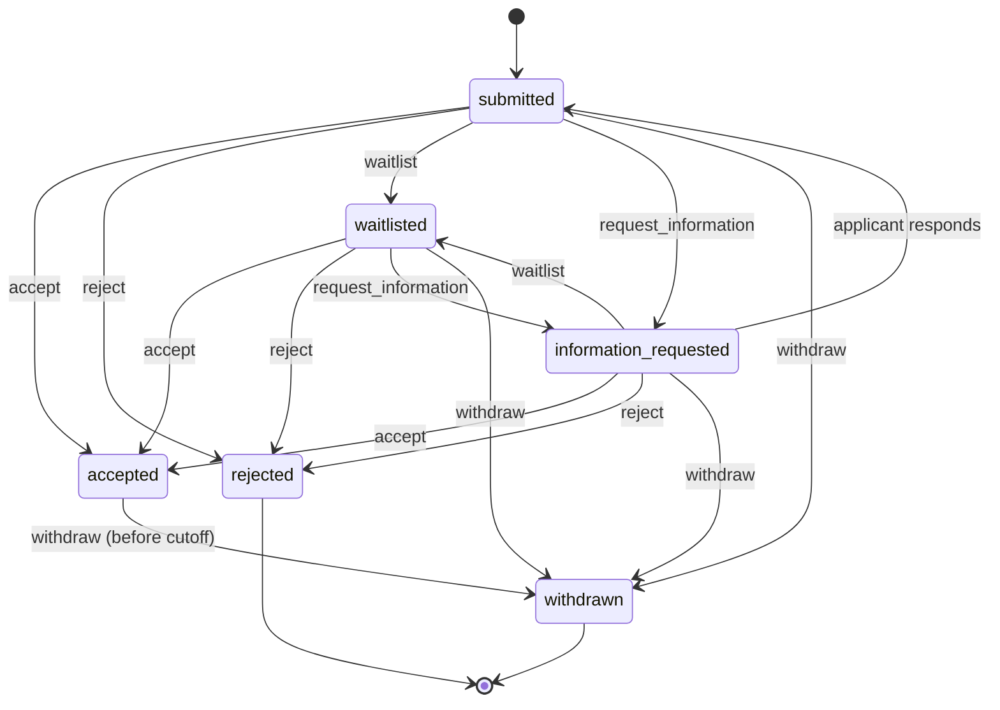

# Mentorship applications: decisions, withdrawal and reapplication

Backend implementation of **MENTOR-035** (structured application decisions)
and **MENTOR-036** (application withdrawal and reapplication), in the
Applications track. Code: [`src/mentorship/`](../../src/mentorship/).

## Endpoints

All routes need a bearer token. Writes marked with ✱ need an
`X-Idempotency-Key` header (8–128 chars of `A-Z a-z 0-9 - _ : .`).

| Method | Path | Roles | Purpose |
| --- | --- | --- | --- |
| POST | `/mentorship/programs` | tutor, admin | Create a program |
| GET | `/mentorship/programs/:programId` | any | Program and its policies |
| GET | `/mentorship/programs/:programId/applications` | program mentor, staff | Review queue (`?status=`) |
| POST ✱ | `/mentorship/programs/:programId/applications` | student | Apply |
| GET | `/mentorship/applications/mine` | student | Own applications |
| GET | `/mentorship/applications/:id` | applicant, program mentor, staff | Applicant or internal view |
| GET | `/mentorship/applications/:id/decisions` | applicant, program mentor, staff | Decision history |
| POST ✱ | `/mentorship/applications/:id/decisions` | program mentor, staff | Record a decision (MENTOR-035) |
| POST | `/mentorship/applications/:id/information-response` | applicant | Answer a request for information |
| GET | `/mentorship/applications/:id/withdrawal-preview` | applicant | Consequences + confirmation token (MENTOR-036) |
| POST ✱ | `/mentorship/applications/:id/withdraw` | applicant | Withdraw (MENTOR-036) |
| POST ✱ | `/mentorship/applications/:id/reapply` | applicant | Reapply (MENTOR-036) |

OpenAPI: every route, DTO field, header and stable error code is documented in
Swagger under **Mentorship Applications** (`/api/docs`).

## State machine



The table lives in
[`domain/application-transitions.ts`](../../src/mentorship/domain/application-transitions.ts).
Anything not listed is refused with `BIZ_MENTORSHIP_INVALID_TRANSITION`; a
withdrawn application refuses every action with
`BIZ_MENTORSHIP_APPLICATION_WITHDRAWN`, a rejected one with
`BIZ_MENTORSHIP_APPLICATION_CLOSED`.

## MENTOR-035 — structured decisions

A decision carries:

| Field | Visible to applicant | Notes |
| --- | --- | --- |
| `type` | yes | `accept`, `reject`, `waitlist`, `request_information`, `withdraw` |
| `applicantReasonCode` | yes | Coarse enum (`capacity_reached`, `strong_fit`, …) |
| `applicantMessage` | yes | Optional, ≤ 2000 chars |
| `internalReasonCode` | **no** | `scoring_threshold`, `conflict_of_interest`, … |
| `internalNote` | **no** | Optional, ≤ 5000 chars |
| `effectiveAt` | — | Defaults to now; future allowed, past refused |
| `communicationPolicy` | — | `notify_immediately`, `notify_at_effective_time`, `silent` |
| `expectedVersion` | — | Optional optimistic-concurrency check |

- **History is immutable.** `mentorship_application_decisions` rejects every
  update/delete operation at the schema level (same pattern as
  `audit_logs`). Each entry has a per-application `sequence`, unique-indexed.
- **Effective time.** Until `effectiveAt`, the applicant view shows the status
  from before the decision and hides the decision. A future decision cannot use
  `notify_immediately`.
- **Accept reserves a seat** with a conditional `$inc` against `capacity`; when
  full the request fails with `BIZ_MENTORSHIP_CAPACITY_REACHED` and the
  reviewer can waitlist instead.
- **Withdraw via this endpoint is staff-only** (acting on the applicant's
  request). Mentors cannot withdraw applicants.

## MENTOR-036 — withdrawal and reapplication

### Withdrawal

1. `GET …/withdrawal-preview` returns what will happen — review stops, record
   kept, whether a held seat is released, and whether / when reapplication is
   possible — plus a `confirmationToken` bound to the application's current
   version.
2. `POST …/withdraw` with `acknowledgeConsequences: true` and that token. If the
   application changed in between (e.g. a decision landed), the token no longer
   matches and the request fails with
   `BIZ_MENTORSHIP_WITHDRAWAL_CONFIRMATION_STALE`, so the applicant always
   confirms the consequences that actually apply.

Effects: status → `withdrawn`, `withdrawnAt`/`closedAt` set, a `withdraw`
decision appended to history, any held seat released exactly once (the release
is gated on the same conditional status update), and the application leaves the
"one active application per program" index. Nothing is deleted. After the
program's `withdrawalCutoffAt`, withdrawal fails with
`BIZ_MENTORSHIP_WITHDRAWAL_CUTOFF_PASSED`.

### Reapplication

`POST /mentorship/applications/:id/reapply` creates a **new** application:

- linked both ways — `previousApplicationId` on the new one,
  `supersededByApplicationId` on the old one (set conditionally, so only one
  reapplication per closed application can ever succeed) — plus
  `rootApplicationId` and `attemptNumber` for the whole chain;
- motivation and goals may be carried over;
- **consent is never copied.** The request must include
  `consent: { accepted: true, version }` and `version` must equal the program's
  current `consentVersion`.

Program policy (`reapplication.mode`, `cooldownHours`, `maxAttempts`):

| Mode | Reapply allowed after |
| --- | --- |
| `not_allowed` | never |
| `after_withdrawal` (default) | a withdrawal |
| `after_any_closure` | a withdrawal or a rejection |

Refusals: `BIZ_MENTORSHIP_REAPPLICATION_NOT_PERMITTED`,
`BIZ_MENTORSHIP_REAPPLICATION_COOLDOWN` (message includes the earliest time),
`BIZ_MENTORSHIP_REAPPLICATION_LIMIT_REACHED`,
`BIZ_MENTORSHIP_ALREADY_REAPPLIED`, `BIZ_MENTORSHIP_PROGRAM_CLOSED`,
`BIZ_MENTORSHIP_CONSENT_VERSION_MISMATCH`.

## Authorization

Deny by default:

- The controller's class-level `@Roles(Role.ADMIN)` applies to any handler that
  does not declare its own roles, so a new route is admin-only until opened up
  on purpose.
- Every service method then checks the resource against the JWT subject:
  **applicant** = `role === student` and `applicantId === sub`; **reviewer** =
  the program's own mentor (`role === tutor` and `mentorId === sub`) or staff
  (`admin`, `moderator`). Everyone else gets 403
  `AUTH_INSUFFICIENT_PERMISSIONS`.
- No DTO carries an applicant or actor id; identity always comes from the token
  (see [resource ownership](../security/resource-ownership.md)).

## Idempotency and concurrency

- Keys are stored on the records they create (`submissionKey` on applications;
  `idempotencyKey` + `requestHash` on decisions, unique per application), not
  in the 24 h response cache, so a retry is answered from the source of truth.
- Same key and same body → original result with `replayed: true`. Same key and
  a different body → 409 `BIZ_MENTORSHIP_IDEMPOTENCY_KEY_REUSED`.
- Every transition is a conditional update on `{status, version}`; a lost race
  returns 409 `BIZ_MENTORSHIP_STALE_VERSION`.
- On replica sets the seat change, status update, decision insert and outbox
  insert share one transaction. On standalone MongoDB they run as guarded
  steps: the application stores the decision it is about to insert in
  `lastTransition`, so a retry after a crash finishes the insert instead of
  deciding twice.

## Background workflow

Applicant notifications go through an outbox
(`mentorship_decision_notifications`, unique on `decisionId`).
`MentorshipDecisionDispatcher` runs every 30 s, claims due rows with a 2-minute
lease, and writes an in-app notification via `NotificationService`. Failed rows
retry up to 5 times. Delivery is at-least-once; the notification metadata
includes `decisionId` for de-duplication. `notify_at_effective_time` rows are
not due until `effectiveAt`; `silent` decisions create no row.

Domain events for other modules (e.g. sessions, payments):
`mentorship.application.decided`, `mentorship.application.withdrawn`,
`mentorship.application.reapplied`. Payloads carry ids and statuses only.

## Telemetry

OpenTelemetry counters (no-op until a meter provider is registered), mirrored
as structured log lines:

| Metric | Attributes |
| --- | --- |
| `mentorship_application_decisions_total` | `type`, `from_status`, `to_status`, `actor_kind` |
| `mentorship_idempotent_replays_total` | `operation` |
| `mentorship_request_rejections_total` | `operation`, `error_code` |
| `mentorship_seat_releases_total` | — |
| `mentorship_reapplications_total` | — |
| `mentorship_decision_notifications_total` | `outcome` |

Privileged writes are also recorded in the immutable audit log:
`mentorship_program.created`, `mentorship_application.decided`,
`mentorship_application.withdrawn`, `mentorship_application.reapplied`.

## Privacy boundaries

- Internal reason codes, internal notes, actor identity, the concurrency
  `version` and the seat reservation are never returned to applicants. The last
  two are hidden because they change when a not-yet-effective decision is
  recorded and would reveal it.
- The notification outbox, domain event payloads and telemetry attributes
  contain no internal reasons and no applicant free text (the outbox carries
  only the applicant-visible message).
- Audit entries record internal reason codes for staff review but not the
  free-text internal note.

## Dependencies

- MongoDB; a replica set is recommended for the transactional path.
- `ScheduleModule.forRoot()` — currently registered by `StellarModule`. If that
  module is removed, register it in `AppModule` or the dispatcher stops.
- `NotificationModule`, `AuditModule` (global), `EventEmitterModule`.
- JWT payloads must carry `sub` and `role`.

## Rollout

1. Deploy: the four collections and their indexes are created by Mongoose on
   boot. No existing data is migrated.
2. Enable on a replica set first, so the transactional path is the one in use.
3. Create programs only once the frontend MENTOR-035/036 screens ship; until
   then the API is reachable but unused.
4. Watch `mentorship_request_rejections_total` by `error_code` and the
   dispatcher's `failed` count after launch.
5. Rollback: remove `MentorshipModule` from `AppModule`. Records persist and
   are picked up again on re-enable; pending outbox rows resume dispatch.

Not yet in scope: escrow/payment release on withdrawal. Withdrawal emits
`mentorship.application.withdrawn` so a payments listener can react once the
smart-contract payment flow exists.

## Corresponding work in other ChainVerse repositories

- **Frontend — MENTOR-035:** reviewer decision form (reason codes, internal
  note, effective time, communication policy) and the applicant timeline that
  only shows effective decisions.
- **Frontend — MENTOR-036:** withdrawal preview/confirm dialog driven by
  `withdrawal-preview`, and a reapply form that always asks for consent again.
- **Smart contracts — MENTOR-036:** releasing or refunding any escrowed
  mentorship payment when an accepted application is withdrawn, triggered from
  the `mentorship.application.withdrawn` event.
# Mentorship applications (MENTOR-030 / MENTOR-031)

Backend implementation of the **Applications** track:

- **MENTOR-030**: create mentorship applications (draft → submit)
- **MENTOR-031**: autosave application drafts

Code lives in [`src/mentorship-applications/`](../../src/mentorship-applications/).

## API

All routes require a bearer token. OpenAPI docs are at `/api` (non-production).

| Method | Path | Role | Purpose |
| --- | --- | --- | --- |
| `GET` | `/mentorship/programs/:programId/application-form` | student, admin, moderator | Current (accepted) form version |
| `POST` | `/mentorship/programs/:programId/application-form` | admin | Publish a new form version |
| `POST` | `/mentorship/applications` | student | Start a draft (`Idempotency-Key` optional) |
| `GET` | `/mentorship/applications?programId=` | student | List my applications / resumable drafts |
| `GET` | `/mentorship/applications/:id` | student | Load a draft to resume |
| `PATCH` | `/mentorship/applications/:id/draft` | student | Autosave (partial, revision-guarded) |
| `POST` | `/mentorship/applications/:id/rebase` | student | Move a draft to the current form version |
| `POST` | `/mentorship/applications/:id/submit` | student | Submit (`Idempotency-Key` optional) |
| `DELETE` | `/mentorship/applications/:id` | student | Discard a draft |

## Lifecycle and guarantees

```
POST /applications ──► draft ──PATCH /draft (autosave)──► draft ──POST /submit──► submitted
                         │                                                          (immutable)
                         └──DELETE──► (removed)
```

**Draft and submit are separate.** Drafts can be partial. Completeness is only checked on submit: goals, expectations, schedule, preferred mode, consent for the form's `consentVersion`, and every required question. Missing items come back in `details.missingFields`.

**One active application.** A partial unique index on `(menteeId, programId)` where `active = true` blocks a second draft or submitted application for the same program. The index holds even when two requests race.

**Accepted form version.** Each draft records the `formVersion` it was written against. Submit is rejected with `BIZ_FORM_VERSION_OUTDATED` if an admin has published a newer version since then. The client calls `/rebase`, which drops answers to removed questions, and the mentee reviews the draft before submitting again.

**Atomic submit.** Submission is one conditional update on `status = draft AND revision = <reviewed revision>`. A concurrent autosave or a duplicate submit cannot interleave with it.

**Submitted applications are immutable.** Autosave, rebase and discard all return `409 BIZ_APPLICATION_NOT_DRAFT` once an application is submitted.

### Autosave and conflict handling

Every write bumps an integer `revision`, which acts as the revision token. The server also tracks, for each field, the revision and timestamp of its last change (`fieldUpdatedAt`). Answers are tracked per question as `answers:<key>`.

The client sends only the changed fields, plus the `baseRevision` it last saw:

- **Same base:** the change applies and `revision` goes up by one.
- **Stale base, different fields:** another device edited other fields. The edits merge.
- **Stale base, same field, different value:** `409 BIZ_DRAFT_REVISION_CONFLICT`. `details.conflicts[]` lists each field with the server's value and timestamp. **Nothing is overwritten.** The client shows both versions and saves again with the new `currentRevision`.
- **Stale base, same field, same value:** not a conflict. It is treated as a no-op.

The write itself is a compare-and-swap on the revision that was read. If a concurrent write lands between the read and the write, the server re-reads and checks again, up to three attempts.

Successful saves return `revision`, `lastSavedAt`, `fieldUpdatedAt` and `savedFields`, so the UI can show "Saved at …".

### Idempotency and offline recovery

- **Autosave:** each save can carry a client-generated `saveId`. The last 50 receipts are stored on the draft. Replaying a `saveId` returns the current draft with `replayed: true` and does not apply the change again. Clients can therefore queue saves while offline and replay them safely on reconnect. A queued save whose fields changed elsewhere in the meantime comes back as a conflict, not as a silent overwrite.
- **Create:** an `Idempotency-Key` is stored as `creationKey`, with a unique index on `(menteeId, creationKey)`. A retry returns the same draft. Reusing a key for a different program returns `BIZ_IDEMPOTENCY_KEY_REUSED`.
- **Submit:** an `Idempotency-Key` is stored as `submissionKey`. A retry, or a concurrent duplicate, returns the submitted application with `replayed: true`. The submitted event is emitted only once.

## Authorization (deny by default)

- **Applications controller:** guarded at class level by `JwtAuthGuard` and `RolesGuard` with `@Roles(STUDENT)`. Every query filters on `menteeId = req.user.id`. Another user's application returns the same `404` as an unknown id, so its existence is not revealed.
- **Forms controller:** every handler declares its roles explicitly. Only admins can publish.
- **Known issue:** on current `main`, [`src/common/decorators/roles.decorator.ts`](../../src/common/decorators/roles.decorator.ts) contains controller code instead of the `Roles` decorator and `ROLES_KEY`. This affects every module that uses `@Roles`. Fix it before rollout, or role checks will not compile or apply.

## Error codes

All errors use the standard error envelope. Some also include a `details` object.

| Code | HTTP | Meaning |
| --- | --- | --- |
| `RES_MENTORSHIP_FORM_NOT_FOUND` | 404 | Program has no current form (not accepting applications) |
| `RES_MENTORSHIP_APPLICATION_NOT_FOUND` | 404 | Unknown id or not yours |
| `BIZ_ACTIVE_APPLICATION_EXISTS` | 409 | Already have an active application; `details.applicationId` |
| `BIZ_DRAFT_REVISION_CONFLICT` | 409 | Stale revision; `details.currentRevision`, `details.conflicts` |
| `BIZ_APPLICATION_NOT_DRAFT` | 409 | Application was already submitted |
| `BIZ_APPLICATION_INCOMPLETE` | 422 | `details.missingFields` |
| `BIZ_FORM_VERSION_OUTDATED` | 422 | Rebase required; `details.currentFormVersion` |
| `BIZ_IDEMPOTENCY_KEY_REUSED` | 422 | Key already used for a different request |
| `VAL_INVALID_REVISION` | 400 | `baseRevision` is ahead of the server |
| `VAL_UNKNOWN_FORM_FIELD` | 400 | Answer key is not on the draft's form version |

## Background workflow and telemetry

- **Event:** on submit, `mentorship.application.submitted` (`DomainEvents.MENTORSHIP_APPLICATION_SUBMITTED`) is emitted. The payload contains identifiers only. Matching, notifications and payment escrow should subscribe to this event rather than poll.
- **Logs:** structured events from `MentorshipApplicationsTelemetry`, all under the `mentorship.application.*` prefix:
  - `draft_created`
  - `draft_saved` (with `attempts` and `replayed`)
  - `draft_conflict` (with conflicting field **names**)
  - `draft_rebased`
  - `draft_discarded`
  - `submitted`
  - `rejected` (with `errorCode`)
  - `mentorship.application_form.published`

## Privacy boundaries

- Application content (goals, expectations, schedule, answers) is readable only by the mentee who owns it through this API. No mentor or admin read endpoint exists yet. Add one as a separate, explicitly authorized route.
- Logs and events never contain mentee-entered text, only ids, revisions, counts and field names.
- Consent records `consentVersion` and a server-set `acceptedAt`, so consent can be audited per form version.

## Dependencies

- MongoDB. Indexes are defined in the schemas and built by Mongoose on startup. In production, build them ahead of time if `autoIndex` is disabled.
- `JwtAuthGuard` and `RolesGuard` from `src/common`. See the roles decorator known issue above.
- `EventEmitterModule` (registered globally in `AppModule`).

## Rollout considerations

1. Fix the `roles.decorator.ts` breakage on `main`.
2. Deploy. The new collections are `mentorship_applications` and `mentorship_application_forms`. The partial unique indexes must exist before traffic arrives.
3. An admin publishes a form version for each program. Programs without a current form reject new applications with `RES_MENTORSHIP_FORM_NOT_FOUND`, which works as a per-program feature switch.
4. Release the frontend autosave client: debounce saves, send `saveId`, keep an offline queue, and add a conflict-resolution UI.

Publishing a form is not transactional. For a moment between the two updates, a program can have no current form, and a create in that window returns 404. Clients should retry once.

## Corresponding work in other ChainVerse repositories

- **Frontend, MENTOR-030:** application form UI, draft and submit flow, a completeness checklist driven by `missingFields`.
- **Frontend, MENTOR-031:** debounced autosave with `saveId`, an offline queue, a "last saved" indicator from `lastSavedAt`, and a conflict-resolution UI from `details.conflicts`.
- **Smart contracts:** nothing is required at the application stage. Payment escrow starts after a match, triggered from the `mentorship.application.submitted` workflow.
